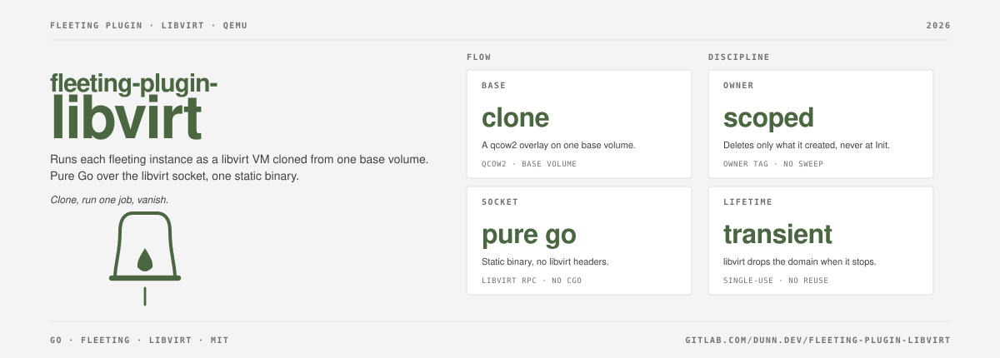

# fleeting-plugin-libvirt

[](https://gitlab.com/dunn.dev/fleeting-plugin-libvirt/-/pipelines)
[](LICENSE)


A [fleeting](https://gitlab.com/gitlab-org/fleeting/fleeting) plugin that runs each instance as a libvirt VM cloned from one base volume.

Each instance is a qcow2 overlay on `base_volume_name` plus a transient domain
that libvirt removes when it stops. The plugin talks to libvirt over its socket
in pure Go, so the binary is static and needs no libvirt headers. It deletes
only what it created under its `name_prefix`, and deletes nothing at Init or Shutdown,
so a restart or a second process with its own `name_prefix` on
the same libvirt never destroys a running instance. No hardware is needed to build or test it.

## Install

Pull a release from this project's container registry with
[fleeting-artifact](https://gitlab.com/gitlab-org/fleeting/fleeting-artifact),
or build `./cmd/fleeting-plugin-libvirt` and put the binary on `PATH`.

```
fleeting-artifact install registry.gitlab.com/dunn.dev/fleeting-plugin-libvirt:0.1
```

Set `FLEETING_PLUGIN_PATH` to the same directory when you install and when you run, or set `plugin` to a binary path.

### Requirements

- A KVM host, and read and write access to the libvirt socket for the account running the plugin.
- For `firmware = "efi"`, libvirt 9.2.0 or newer on the host, checked at Init, and OVMF qcow2 firmware descriptors installed.
- A base image as described under Guest in How it behaves.

### Verify a release

```
cosign verify \
  --certificate-identity-regexp '^https://gitlab\.com/dunn\.dev/fleeting-plugin-libvirt//\.gitlab-ci\.yml@refs/tags/.+$' \
  --certificate-oidc-issuer https://gitlab.com \
  registry.gitlab.com/dunn.dev/fleeting-plugin-libvirt:0.1
```

## Use with GitLab Runner

```toml
[runners.autoscaler]
  plugin = "registry.gitlab.com/dunn.dev/fleeting-plugin-libvirt:0.1"

  [runners.autoscaler.plugin_config]
    pool_name = "images"
    base_volume_name = "golden.qcow2"
    name_prefix = "ci-"

  [runners.autoscaler.connector_config]
    username = "root"
```

## Use with forgehand

```toml
[[scalesets]]
name = "example"
url = "https://github.com/owner/repo"
labels = ["self-hosted", "example"]

[scalesets.github_app]
client_id = "Iv1.0000000000000000"
installation_id = 12345678
private_key_path = "/run/credentials/forgehand.service/app.pem"

[scalesets.runner]
dir = "/opt/actions-runner"

[scalesets.autoscaler]
plugin = "registry.gitlab.com/dunn.dev/fleeting-plugin-libvirt:0.1"
max_instances = 4

[scalesets.autoscaler.plugin_config]
pool_name = "images"
base_volume_name = "golden.qcow2"
name_prefix = "forgehand-"

[scalesets.autoscaler.connector_config]
protocol = "ssh"
username = "runner"
```

`name_prefix` must differ from every other daemon's on the same libvirt.

## Configuration

An unknown key fails Init and names the key.

| Key | Default | Meaning |
|---|---|---|
| `uri` | `qemu:///system` | libvirt URI |
| `pool_name` | required | storage pool of the base volume and the overlays |
| `base_volume_name` | required | volume that instances clone |
| `name_prefix` | required | must end in `-`; every domain and volume is named `<prefix><tag>-<id>` |
| `max_size` | unbounded | upper bound on instances; the scaler's own cap applies either way |
| `firmware` | `bios` | `bios` for the legacy BIOS domain, or `efi` for libvirt firmware autoselection on machine `q35` with a qcow2 loader |
| `secure_boot` | `false` | requires `firmware = "efi"`; selects secure-boot firmware with `enrolled-keys` off and turns SMM on |
| `vcpu_count` | 2 | vCPUs per instance |
| `memory_mib` | 4096 | memory per instance |
| `disk_size_gib` | base size | overlay size, never below the base volume |
| `network_name` | `default` | libvirt network for the one interface |
| `title` | none | domain `<title>`, one line |
| `resource_partition` | none | cgroup partition such as `/machine/ci`; it must exist |
| `lock_file` | none | held across admission, volume creation and start of each instance; waiting longer than five minutes for it refuses that Increase. Use a directory that is not sticky and world-writable (for example under `/run`), shared by every account that runs the plugin |
| `admit_command` | none | run with `/bin/sh -c` under the lock; non-zero refuses that instance, and it is killed with its children after two minutes. Requires `lock_file` |

`admit_command` sees `FLEETING_LIBVIRT_NAME`, `FLEETING_LIBVIRT_MEMORY_MIB` and
`FLEETING_LIBVIRT_VCPU_COUNT`. A refusal stops Increase; the instances already
started are returned without an error, and fleeting asks again later.

### Secure boot hazard

The secure-boot firmware descriptors require SMM, so `secure_boot` turns it on, and plain `efi` leaves it off. Under nested KVM, SMM can hang the guest kernel at ExitBootServices; the instance then never reaches sshd. Use `secure_boot` only on hosts that are not themselves guests.

## How it behaves

- **Ownership.** Domains are listed by `name_prefix`. A domain or volume is ours when it carries our `name_prefix`. Domains match by their metadata prefix; Update, Decrease and orphan reaping all use that rule. Volumes carry no metadata, so they match by a tag derived from the prefix in their
  name: Decrease deletes a volume only under a minted name, and with no domain
  it removes only minted names. Update reports only our domains, all as
  running; a stopped or paused domain is removed only when the caller runs
  Heartbeat (forgehand with a heartbeat function, or the runner with
  `FF_USE_FLEETING_ACQUIRE_HEARTBEATS`), which fails and leads to Decrease.
  Update also deletes our volumes that have no domain and no create in
  flight, and never reports them.
- **Keys.** With `use_static_credentials` false, one ed25519 key is generated
  at Init; its public half is seeded into each guest as an SMBIOS credential and
  the private half is returned in ConnectInfo. The key is per plugin process
  and is seeded as `ssh.authorized_keys.<connector_config.username>` (`root`
  when empty). With it true nothing is seeded
  and `connector_config` passes through, so the base image must trust that key.
- **Guest.** The base image boots with legacy BIOS on x86-64 with a virtio disk
  and NIC, and needs the QEMU guest agent, which supplies the address, and
  systemd to import the credential. Never overwrite the base volume while
  instances run on overlays of it: upload a new volume name, change
  `base_volume_name`, and let old instances drain. systemd's stock
  `provision.conf` imports only `ssh.authorized_keys.root`, so a non-root SSH
  account needs a oneshot unit that imports its own credential and writes the
  file before sshd starts (shown for `username = "runner"`):

  ```ini
  [Unit]
  DefaultDependencies=no
  After=local-fs.target
  Before=ssh.socket sshd.service

  [Service]
  Type=oneshot
  RemainAfterExit=yes
  ImportCredential=ssh.authorized_keys.runner
  ExecStart=/bin/sh -c 'install -d -m 700 -o runner -g runner /home/runner/.ssh && install -m 600 -o runner -g runner "$CREDENTIALS_DIRECTORY/ssh.authorized_keys.runner" /home/runner/.ssh/authorized_keys'

  [Install]
  WantedBy=multi-user.target
  ```

- **Address and health.** ConnectInfo waits up to two minutes for the agent's
  address on the interface carrying the domain's MAC (IPv4 first, then global
  IPv6; never loopback or link-local), so bridges and container networks in
  the guest are ignored. It then waits within the same two minutes for the SSH
  port (`protocol_port`) to accept connections. Heartbeat needs a running domain
  and an open SSH port.
- **Connection.** The libvirt connection is redialed on the next call after
  libvirtd drops it.
- **Removal.** Decrease destroys the domain and deletes the volume, and treats
  missing ones as done.
